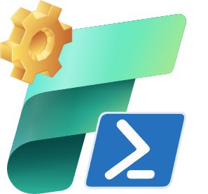

<!-- markdownlint-disable MD033 MD041 -->
<p align="center">
  
</p>

<h1 align="center">FabricTools</h1>

<p align="center">
  <strong>Automate Microsoft Fabric and Power BI administration from PowerShell.</strong>
</p>

<p align="center">
  <a href="https://www.powershellgallery.com/packages/FabricTools"></a>
  <a href="https://www.powershellgallery.com/packages/FabricTools"></a>
  <a href="https://dataplat.github.io/FabricTools/"></a>
  <a href="LICENSE"></a>
</p>

<p align="center">
  <a href="https://dataplat.github.io/FabricTools/"><strong>📖 Documentation</strong></a> ·
  <a href="#quick-start"><strong>🚀 Quick start</strong></a> ·
  <a href="CHANGELOG.md"><strong>📝 Changelog</strong></a> ·
  <a href="docs/MATURITY.md"><strong>📊 Cmdlet maturity</strong></a>
</p>
<!-- markdownlint-enable MD033 MD041 -->

---

FabricTools gives you more than 200 cmdlets to manage Microsoft Fabric from a script or a pipeline: workspaces, capacities, items such as lakehouses, warehouses, notebooks and data pipelines, Git integration, deployment pipelines, connections, schedules and tenant settings. It works with Windows PowerShell 5.1 and PowerShell 7 on Windows and Linux.

> [!NOTE]
> FabricTools is in **public preview**. Cmdlets are still changing between releases, and not all of them are equally mature. Check the [cmdlet maturity report](docs/MATURITY.md) to see how well each cmdlet is tested before you rely on it in production.

## Quick start

```powershell
# Install from the PowerShell Gallery
Install-Module FabricTools -Scope CurrentUser

# Sign in (opens the interactive account picker)
Connect-FabricAccount -TenantId '<tenant-id>'

# Explore
$workspace = Get-FabricWorkspace -WorkspaceName 'Sales'
Get-FabricLakehouse -WorkspaceId $workspace.id
```

The access token is checked before every call and, by default, renewed automatically when it expires, so long-running scripts keep working.

## What you can do

Each area links to its cmdlets on the [documentation website](https://dataplat.github.io/FabricTools/), where you can search every cmdlet and see its syntax, parameters and examples.

| Area | Examples |
| ---- | -------- |
| [Workspaces](https://dataplat.github.io/FabricTools/#type=Workspace) | Create and update workspaces, manage role assignments, assign capacities |
| [Capacities](https://dataplat.github.io/FabricTools/#type=Capacity) | List capacities and SKUs, suspend and resume, check workloads |
| [Items](https://dataplat.github.io/FabricTools/#type=Item) | Lakehouses, warehouses, notebooks, data pipelines, semantic models, reports, KQL databases, eventhouses, eventstreams, environments, Spark job definitions, ML models and more |
| [Git integration](https://dataplat.github.io/FabricTools/#type=Git) | Connect a workspace to Git, check status, commit and update |
| [Deployment pipelines](https://dataplat.github.io/FabricTools/#type=Deployment%20Pipeline) | Create pipelines, assign stages and deploy content |
| [Domains](https://dataplat.github.io/FabricTools/#type=Domain) and [tenant](https://dataplat.github.io/FabricTools/#type=Tenant) | Organise workspaces into domains, read and override tenant settings |
| [Core](https://dataplat.github.io/FabricTools/#type=Core) | Sign-in, connections, and `Invoke-FabricRestMethod` for any Fabric API not yet covered by a cmdlet |

## Signing in

`Connect-FabricAccount` supports interactive sign-in, device code and service principals.

```powershell
# Interactive user sign-in
Connect-FabricAccount -TenantId '<tenant-id>'

# Device code, for terminals that cannot show the account picker
Connect-FabricAccount -UseDeviceAuthentication

# Service principal: the username is the application (client) ID, the password is the client secret
$credential = Get-Credential -UserName '<app-id>' -Message 'Client secret'
Connect-FabricAccount -TenantId '<tenant-id>' -Credential $credential
```

## Examples

### Pause and resume a capacity

```powershell
$capacity = @{
    SubscriptionID = '<subscription-id>'
    ResourceGroup  = 'rg-fabric'
    Capacity       = 'fabriccapacity01'
}
Suspend-FabricCapacity @capacity
Resume-FabricCapacity @capacity
```

### Run a data pipeline and wait for it to finish

```powershell
$run = @{
    WorkspaceId      = $workspace.id
    DataPipelineName = 'Daily load'
    Parameters       = @{ loadDate = (Get-Date -Format 'yyyy-MM-dd') }
}
Start-FabricDataPipeline @run
```

### Commit workspace changes to Git

```powershell
Get-FabricGitStatus -WorkspaceId $workspace.id -ChangesOnly
Invoke-FabricGitCommit -WorkspaceId $workspace.id -Comment 'Nightly sync'
```

### Assign workspaces to a capacity

```powershell
$capacity = Get-FabricCapacity -CapacityName 'fabriccapacity01'
Get-FabricWorkspace |
    Where-Object displayName -like 'Sales*' |
    ForEach-Object { Add-FabricWorkspaceCapacity -WorkspaceId $_.id -CapacityId $capacity.id }
```

### Call any Fabric REST API

```powershell
Invoke-FabricRestMethod -Uri 'workspaces' -Method Get
```

## Requirements

- Windows PowerShell 5.1 or PowerShell 7+, on Windows or Linux
- A Microsoft Fabric or Power BI tenant, and permissions for the objects you manage
- An Azure subscription, only for the capacity cmdlets that use Azure Resource Manager (for example `Suspend-FabricCapacity`)
- The modules Az.Accounts, Az.Resources and PSFramework, which are installed automatically by `Install-Module FabricTools`

## Contributing

Contributions are welcome. Pull requests target the `develop` branch.

```powershell
git clone https://github.com/dataplat/FabricTools.git
cd FabricTools
./build.ps1 -ResolveDependency -Tasks noop   # first time only
./build.ps1 -Tasks build, test
```

See [CONTRIBUTING.md](CONTRIBUTING.md) for the development workflow and conventions, and the [Code of Conduct](CODE_OF_CONDUCT.md) for how we work together.

## Authors

_In alphabetical order:_

- **Tiago Balabuch** ([tiagobalabuch](https://github.com/tiagobalabuch)): wrote most of the cmdlets and made the module robust and well organised
- **Ioana Bouariu** ([Jojobit](https://github.com/Jojobit)): initial work
- **Frank Geisler** ([Frank-Geisler](https://github.com/Frank-Geisler)): Real-Time Intelligence cmdlets
- **Kamil Nowinski** ([NowinskiK](https://github.com/NowinskiK)): refactoring, unification and further cmdlets
- **Jess Pomfret** ([jpomfret](https://github.com/jpomfret)): automation and PowerShell expertise
- **Rob Sewell** ([SQLDBAWithABeard](https://github.com/SQLDBAWithABeard)): automation, DevOps, governance and experience from dbatools

See also everyone who has [contributed](https://github.com/dataplat/FabricTools/contributors).

## Acknowledgments

- [**Rui Romano**](https://github.com/RuiRomano), whose [Fabric PowerShell module](https://github.com/microsoft/Analysis-Services/tree/master/pbidevmode/fabricps-pbip) is included in FabricTools with his permission.

## License

FabricTools is licensed under the [MIT License](LICENSE).

## Star history

[](https://www.star-history.com/#dataplat/FabricTools&type=date&legend=top-left)
